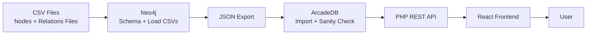

# ShodhanaKG: An Ayurvedic Knowledge Graph for Disease and Compound Shodhana

## Overview

ShodhanaKG stores the curated knowledge in an ArcadeDB graph and exposes it through a web portal and a graph-grounded chatbot. The graph has 2,532 total nodes, 10,123 total relationships, 17 vertex types, 21 edge types, extracted from 410 articles from PubMed and the AYUSH Research Portal. Browse it at [https://webs.iiitd.edu.in/raghava/shodhanakg/](https://webs.iiitd.edu.in/raghava/shodhanakg/).

## Pipeline



## Features

- Three exploration modes: Disease Explorer (ayurvedic diagnosis, symptoms, dosha, therapy), Compound Explorer (compounds, Shodhana methods, media, processes), and Integrated Explorer (linking purified compounds to treated diseases).
- Interactive graph visualization using Cytoscape.js with multiple layout options (concentric, breadthfirst, cose, circle, grid) and progressive node/edge batching.
- Provenance and literature evidence tracing linking graph paths to PubMed, DOI, and AYUSH Research Portal publications.
- High-performance data tables with connection counts and direct graph view navigation.
- Global statistics dashboard displaying node, edge, and reference counts.
- Search and multi-hop query interfaces across vertices, properties, and constraints.
- Graph-grounded chatbot assistant for natural-language questions with deterministic factual retrieval.
- Colorblind accessibility palette mode.

## Technology

### Frontend
- Framework: React 18 (`react` `^18.3.1`, `react-dom` `^18.3.1`) with Vite 7 (`vite` `^7.3.7`)
- Language: TypeScript (`typescript` `^5.8.3`)
- Styling: Tailwind CSS 4 (`tailwindcss` `^4.3.3`) and Radix UI primitives (`@radix-ui/*`)
- Graph Visualization: Cytoscape.js (`cytoscape` `^3.33.2`)
- State and Data Fetching: TanStack React Query (`@tanstack/react-query` `^5.83.0`)
- Routing: React Router (`react-router-dom` `^7.18.4`)
- Charts: Recharts (`recharts` `^2.15.4`)
- Icons: Lucide React (`lucide-react` `^0.462.0`)
- Forms and Validation: React Hook Form (`react-hook-form` `^7.61.1`) and Zod (`zod` `^3.25.76`)
- Unit Testing: Vitest (`vitest` `^5.0.3`)
- Browser Testing: Playwright (`@playwright/test` `^1.60.0`)
- Node.js Engine Requirement: `^22.12.0` || `^24.0.0` || `>=26.0.0`

### Backend
- Language: PHP 5.6.40+
- Database: ArcadeDB (multi-model graph database)
- LLM: Llama 3.2 3B (default model `llama3.2` via Ollama)
- Testing and Evaluation: Python 3.8+ (standard library with `pandas>=2.0.0`)

## Chatbot

The chatbot uses a deterministic graph-retrieval pipeline across 53 allowlisted ArcadeDB traversal endpoints to retrieve factual subgraphs and correlate citations (PubMed ID, DOI, AYUSH ID) across edges without cross-join hallucinations. Answers are constructed deterministically directly from retrieved graph facts. A local Ollama instance running Llama 3.2 (3B parameter model, default tag `llama3.2`) can be enabled for conversational phrasing and language assistance without generating ungrounded facts.

## Setup

### Prerequisites

- Node.js (version 22+ recommended; package.json requires `^22.12.0` || `^24.0.0` || `>=26.0.0`)
- PHP 5.6.40+
- ArcadeDB running locally or accessible via network
- Neo4j latest (Desktop or Server)
- Ollama with Llama 3.2 3B (for conversational chatbot assistance)

### 1. Database Setup

Populate and verify the knowledge graph in Neo4j latest (Desktop or Server) and ArcadeDB:

1. **Load CSVs into Neo4j**: The source CSV files are provided in `data/csv/nodes/` and `data/csv/relations/`. Copy node CSV files and relationship CSV files into the Neo4j latest (Desktop or Server) `import` directory, then execute [`Create_graph.Cypher`](arcadedb/Create_graph.Cypher) to create constraints, 17 vertex types, and 21 edge types:
   ```bash
   cat arcadedb/Create_graph.Cypher | cypher-shell -u username -p password -d neo4j
   ```
2. **Export Graph to JSON**: Ensure `apoc.export.file.enabled=true` in Neo4j's `conf/apoc.conf` and execute [`Export.Cypher`](arcadedb/Export.Cypher):
   ```cypher
   CALL apoc.export.json.all("neo4j-export.json", {});
   ```
3. **Start ArcadeDB Server**:
   ```bash
   bin/server.sh
   ```
4. **Import JSON into ArcadeDB & Run Sanity Checks**:
   Execute [`Migrate_to_ArcadeDB.sql`](arcadedb/Migrate_to_ArcadeDB.sql) via the ArcadeDB console:
   ```bash
   bin/console.sh arcadedb/Migrate_to_ArcadeDB.sql
   ```
   Or run the commands interactively:
   ```sql
   CONNECT remote:localhost username password;
   CREATE DATABASE shodhana;
   DISCONNECT;
   CONNECT remote:localhost/shodhana username password;
   IMPORT DATABASE file:///data/graph_export/neo4j-export.json;
   ```
   The ArcadeDB server reads this path. Adjust it if the repository is at a different location on the server.

   Run sanity checks to verify 2,532 total nodes, 10,123 total relationships, 17 vertex types, 21 edge types, 0 edges missing `ref`, and 0 vertices missing `name`.
5. **Verify Database Connectivity**:
   Configure database connection variables in `webservice/api/config.php` or `.env`:
   - ARCADE_URL: `http://localhost:2480`
   - ARCADE_DB: `shodhana`
   - ARCADE_USER: `username`
   - ARCADE_PASS: `password`

   Verify that ArcadeDB is listening:
   ```bash
   curl http://localhost:2480/api/v1/ready
   ```

### 2. Backend Setup

Start the built-in PHP server pointing to the webservice directory so `/api/` endpoints resolve:

```bash
php -S 127.0.0.1:8081 -t webservice
```

Verify backend connectivity:
```bash
curl http://localhost:8081/api/health.php
```

### 3. Frontend Setup

Install dependencies and start the Vite development server:

```bash
cd webservice/frontend
npm install
npm run dev
```

The application will be available at `http://localhost:8080`.

### 4. Chatbot Setup

If using conversational narrative mode via Ollama:

```bash
ollama serve
ollama pull llama3.2
```

Verify chatbot health:

```bash
curl http://localhost:8081/api/chatbot_health.php
```

## Testing

Run frontend unit and component tests (Vitest):

```bash
npm --prefix webservice/frontend test
```

Run frontend typecheck:

```bash
npm --prefix webservice/frontend run typecheck
```

Run frontend linter:

```bash
npm --prefix webservice/frontend run lint
```

Run end-to-end browser tests (Playwright; requires running dev server):

```bash
npx --prefix webservice/frontend playwright test
```

Run route smoke tests:

```bash
npx --prefix webservice/frontend playwright test --grep "Route smoke"
```

Run backend Python unit tests:

```bash
python -m unittest discover -s webservice/api/tests -p "test_*.py"
```

Run backend evaluation cases (covering all 53 allowlisted endpoints):

```bash
php webservice/api/tests/run_evaluation_cases.php
```

Run complete release verification suite:

```bash
python -B webservice/api/tests/run_release_checks.py
```

## Project Structure

```text
ShodhanaKG/
├── data/                 Raw datasets and graph exports
│   ├── csv/              Curated CSV files
│   │   ├── nodes/        Node CSV files
│   │   └── relations/    Relationship CSV files
│   └── graph_export/     JSON graph exports for database import
├── arcadedb/             Database schema, import, and migration scripts
│   ├── Create_graph.Cypher
│   ├── Export.Cypher
│   └── Migrate_to_ArcadeDB.sql
├── webservice/           Application source code
│   ├── frontend/         React single-page application (Vite, TypeScript, Tailwind)
│   │   ├── src/          Application UI components, pages, hooks, and lib
│   │   ├── public/       Static web assets and fonts
│   │   └── tests/        Playwright end-to-end browser tests
│   └── api/              PHP backend web services
│       ├── core/         Modular query execution, router, and LLM transport
│       ├── tests/        PHP and Python unit and evaluation tests
│       │   ├── contracts/ JSON schema contracts
│       │   └── fixtures/  Frozen ground truth datasets and snapshots
│       └── storage/      Runtime cache and logs
├── docs/                 Documentation and technical reports
│   ├── webservice/       Frontend, backend API, and deployment guides
│   ├── chatbot/          Chatbot architecture and usage guides
│   │   └── dev_docs/     Chatbot developer documentation
│   ├── evaluation/       Evaluation guide and test suites
│   ├── arcadedb/         ArcadeDB migration and Neo4j schema guides
│   └── general/          Project changelog
├── scripts/              Packaging and release utilities
├── LICENSE               MIT License
├── QUICK_START.md        Quick start and local setup guide
└── README.md             Project overview and setup guide
```

## Detailed Documentation

- [Quick Start Guide](QUICK_START.md)

### Web Service Guides (`docs/webservice/`)
- [Frontend Documentation](docs/webservice/FRONTEND_DOCUMENTATION.md)
- [Backend Documentation](docs/webservice/BACKEND_DOCUMENTATION.md)
- [Deployment Guide](docs/webservice/DEPLOYMENT.md)
- [Release Package](docs/webservice/RELEASE_PACKAGE.md)

### Chatbot Documentation (`docs/chatbot/`)
- [Chatbot Documentation](docs/chatbot/CHATBOT.md)
- [Chatbot Usage Guide](docs/chatbot/chatbot_usage_guide.md)

#### Developer Documentation (`docs/chatbot/dev_docs/`)
- [Answer Construction](docs/chatbot/dev_docs/ANSWER_CONSTRUCTION.md)
- [Conversational Answers](docs/chatbot/dev_docs/CONVERSATIONAL_ANSWERS.md)
- [System Status](docs/chatbot/dev_docs/CURRENT_SYSTEM_STATUS.md)
- [Orchestration Layer](docs/chatbot/dev_docs/ORCHESTRATION_LAYER.md)
- [Retrieval Core](docs/chatbot/dev_docs/RETRIEVAL_CORE.md)

### Database Documentation (`docs/arcadedb/`)
- [ArcadeDB Migration & Sanity Checks Guide](docs/arcadedb/README_ArcadeDB.md)
- [Neo4j Schema & Loading Guide](docs/arcadedb/README_Neo4j.md)

### Evaluation Documentation (`docs/evaluation/`)
- [Evaluation Guide](docs/evaluation/EVALUATION_GUIDE.md)

### General Documentation (`docs/general/`)
- [Changelog](docs/general/CHANGELOG.md)

## Citation

Nagarkoti S, Sood R, Gahlot PS, Raghava GPS.
ShodhanaKG: An Ayurvedic Knowledge Graph for Disease and Compound Shodhana.

## License

This project is licensed under the MIT License - see the [LICENSE](LICENSE) file for details.
