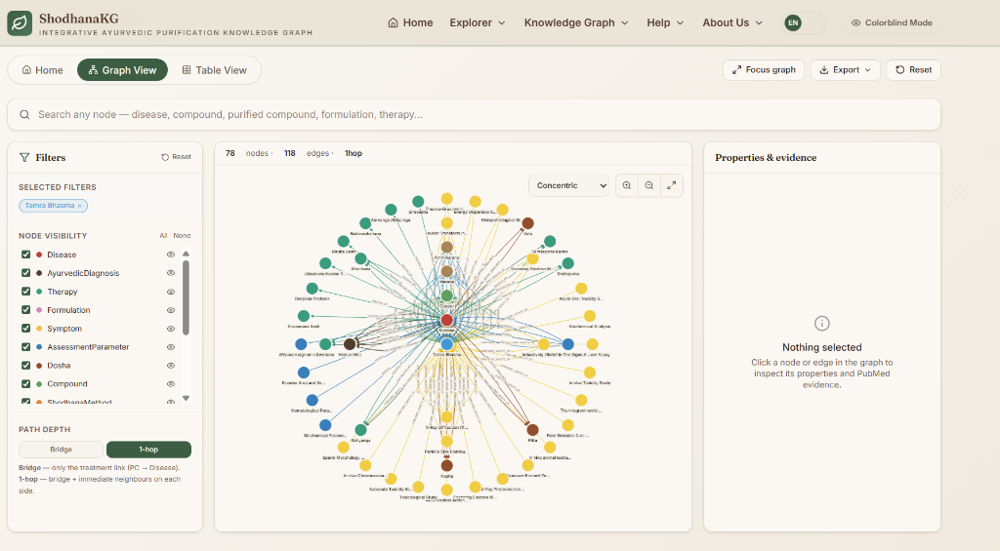
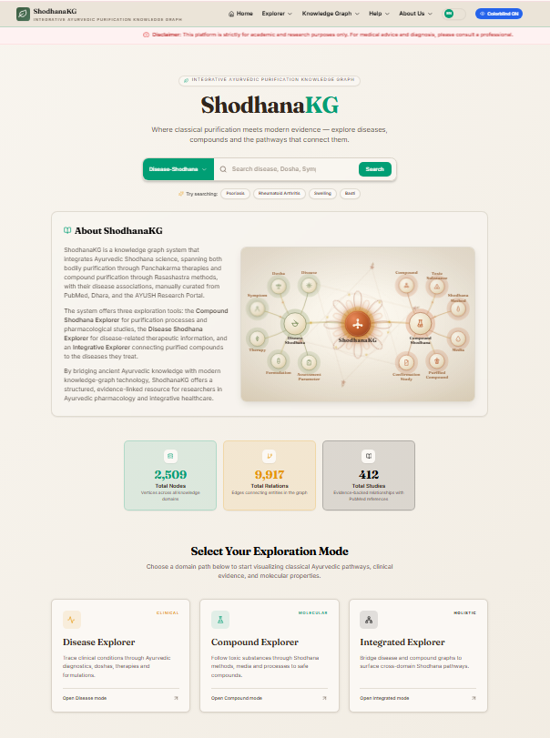
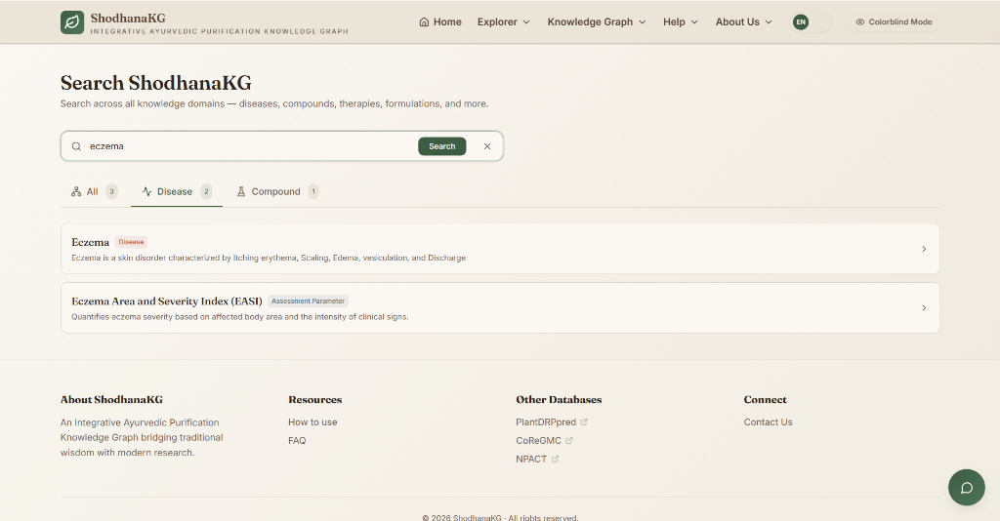
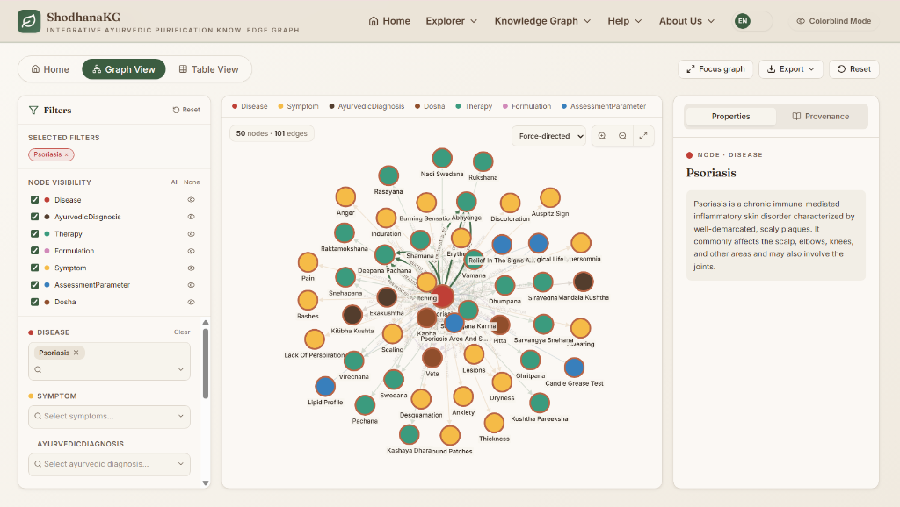
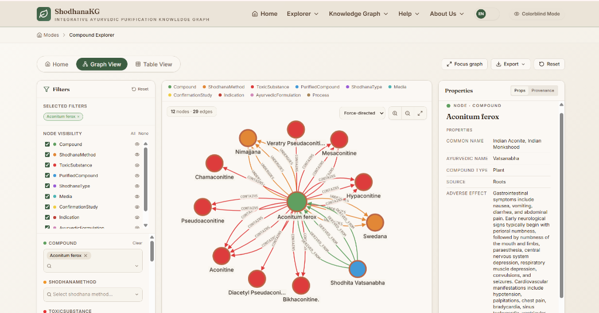

# ShodhanaKG Explorer Suite



## Overview
The **ShodhanaKG Explorer Suite** is an advanced Knowledge Graph platform dedicated to the visualization and analysis of Ayurvedic medical knowledge. It specifically focuses on the relationship between **Ayurvedic Diseases** and the **Shodhana (Purification)** of medicinal compounds.

The project bridges the gap between traditional clinical diagnostics and pharmacological processing protocols, providing researchers with a high-performance, interactive exploration tool.

---

## 🚀 Key Features

- **Triple Explorer Modes**:
  - **Disease Explorer**: Navigate the clinical landscape of Ayurvedic diagnostics, symptoms, and therapies.
  - **Compound Explorer**: Explore the chemical and biological transformation of medicinal substances through Shodhana protocols.
  - **Integrated Explorer**: The "Bridge" view connecting purified compounds directly to the diseases they treat.
- **Interactive Graph Visualization**: Powered by **Cytoscape.js**, offering force-directed, hierarchical, and concentric layouts.
- **Evidence-Based Provenance**: Track every relationship back to its scientific source via PubMed ID integration.
- **Real-time Analytics**: Global dashboard showing node counts, unique relationship types, and deduplicated research study metrics.
- **Language Toggle (English/Hindi)**: Seamlessly switch the interface language between English and Hindi using the built-in toggle in the top navigation.
- **Responsive Table Views**: High-performance data tables with connection counts and deep-linking to graph views.

---

## 🛠 Technology Stack

### Frontend
- **Framework**: React 18 + Vite 5
- **Language**: TypeScript
- **Styling**: Tailwind CSS 3 + shadcn/ui (Radix primitives)
- **Visualization**: Cytoscape.js (5 layouts: force-directed, hierarchical, circular, concentric, grid)
- **Data Fetching**: @tanstack/react-query v5
- **Routing**: react-router-dom v6 (nested routes, lazy-loaded graph views)
- **Icons**: lucide-react
- **Charts**: recharts
- **Forms**: react-hook-form + zod

### Backend
- **Language**: PHP 5.6.40+ (Legacy-compatible)
- **Database**: ArcadeDB (Multi-model Graph Database)
- **API Protocol**: ArcadeDB REST v1 via cURL → `file_get_contents` → `fsockopen` (3-tier fallback)

---

## 🤖 AI Chatbot Assistant

The ShodhanaKG Explorer includes a **graph-grounded AI chatbot** that answers 
questions about Ayurvedic compounds, diseases, therapies, and Shodhana processes 
using a deterministic retrieve-then-generate architecture.

### Architecture
- **Deterministic retrieval** via 27 schema-aware ArcadeDB traversal endpoints
- **Evidence correlation** prevents cross-join hallucinations
- **LLM rendering** via Ollama (llama3.2) narrates pre-retrieved facts
- **Response validation** detects hallucinated identifiers, quantities, and entities

### Enable the Chatbot
Set `VITE_CHAT_ENABLED=true` in `.env` and configure Ollama:
```bash
# Install and start Ollama locally
ollama serve
ollama pull llama3.2
```
*Note: The PHP backend (`api/core/LLMClient.php`) is configured with a 120-second timeout to allow sufficient generation time on local CPU setups without timing out.*


### Example Questions
- "What media is used for purifying Copper?"
- "What are the symptoms of Alopecia?"
- "What shodhana methods does Mercury undergo?"
- "What diseases can purified Croton tiglium treat?"
- "Compare the purification of Copper and Zinc"

📖 **[Full Chatbot Documentation →](docs/chatbot/README.md)**

---

## 📦 Installation & Setup

### Prerequisites
- **Node.js** (v18+)
- **PHP** (v5.6.40+)
- **ArcadeDB** (Running locally or accessible via network)

### 1. Database Setup
Ensure ArcadeDB is running. The default local configuration points to the `IntegratedKG` database.
Default credentials (change in `api/config.php` or via environment variables):
- **Database**: `IntegratedKG`
- **User**: `readonly`
- **Password**: `readonly`

### 2. Backend Setup
The backend is a lightweight PHP webservice. Run the built-in PHP server from the **project root directory** (so `/api/` paths resolve correctly):
```bash
php -S 127.0.0.1:8081 -t .
```

### 3. Frontend Setup
Install dependencies and start the Vite development server:
```bash
npm install
npm run dev
```
The application will be available at `http://localhost:8080`.

### 4. Testing
Run unit and integration tests using Vitest:
```bash
npm test             # Run once
npm run test:watch   # Watch mode
```
Run end-to-end tests using Playwright (requires dev server running):
```bash
npx playwright test
npx playwright test --grep "Route smoke"
```

---

## 📸 Screenshots

| Homepage | Search Results |
| :---: | :---: |
|  |  |

| Disease Graph | Compound Graph |
| :---: | :---: |
|  |  |

---

## 📄 Documentation

### Detailed Guides
- **[Frontend Documentation](./FRONTEND_DOCUMENTATION.md)** — Complete React component tree, state management, graph visualization internals, page-by-page breakdown, styling system, testing, and build configuration.
- **[Backend Documentation](./BACKEND_DOCUMENTATION.md)** — PHP API architecture, ArcadeDB schema (17 vertex types, 22 edge types), 3-tier connection fallback, all 11 API endpoints, deployment, and testing.
- **[API Implementation Plan](./DETAILED_IMPLEMENTATION_PLAN.md)** — Backend architecture decisions, ArcadeDB SQL patterns, and environment constraints.
- **[Deployment Guide](./DEPLOYMENT.md)** — Production deployment steps for frontend, backend, and database.

---

## 📁 Project Structure

```text
api/                    # PHP Backend (endpoints + core services + tests)
  config.php            #   Env var defaults (ARCADE_URL, DB, user, pass)
  db.php                #   ArcadeDB 3-tier connection (cURL → fopen → fsockopen)
  cors.php              #   CORS header management
  response.php          #   JSON response helpers (api_ok, api_fail)
  graph_service.php     #   Shared schema mapping, traversal, normalization
  search.php            #   Full-text search across vertex types
  graph.php             #   Subgraph traversal (disease/compound/integrated)
  node.php              #   Single node + neighbors + evidence
  category-stats.php    #   Per-category stats with edge config
  kg-stats.php          #   Global KG node/relation/study counts
  counts.php            #   Per-category entity counts
  bridge-stats.php      #   Integrated bridge table data
  provenance-subgraph.php  # Disease→Therapy→Formulation provenance
  compound-provenance.php  # Compound→ShodhanaMethod→Media provenance
  health.php            #   ArcadeDB connectivity health check
  chatbot_response.php  #   Deterministic graph-grounded question answering
  chatbot_health.php    #   Chatbot health and readiness endpoint
  core/                 #   Chatbot orchestration, entity resolution, and response validation
  tests/                #   PHP unit tests

src/
  main.tsx              # Entrypoint → <App />
  App.tsx               # Providers + routing (16 routes, lazy-loaded)
  index.css             # HSL design tokens, colorblind mode, utilities
  lib/
    api.ts              # HTTP client + 7 React Query hooks
    types.ts            # ApiNode, ApiEdge, Domain, ProvenancePath, etc.
    utils.ts            # cn() helper
    graphExport.ts      # CSV/JSON/PNG export
  hooks/
    useColorblind.tsx   # Colorblind mode context (localStorage-persisted)
    use-toast.ts        # shadcn toast state
    use-mobile.tsx      # Responsive detection
  data/
    entityTypes.ts      # Shared entity definitions, colors, domain mappings, labels
    diseaseGraph.ts     # Disease graph schema, node/edge types, cytoscape styles
    compoundGraph.ts    # Compound graph schema, node/edge types, cytoscape styles
    integratedGraph.ts  # Integrated graph schema, types, and colors
  components/
    ui/                 # 49 shadcn/ui boilerplate components
    layout/             # AppLayout, TopNav
    explorer/           # GraphCanvas, DetailsPanel, MultiAutocomplete,
                        # Legend, ExportMenu, ProvenancePanel,
                        # CompoundProvenancePanel, GraphProvenance
    chatbot/            # ChatbotWidget
  pages/
    Index.tsx           # Re-exports ModeSelection
    ModeSelection.tsx   # Landing: hero, search, KG stats, 3 mode cards
    SearchResults.tsx   # Cross-domain search with tabs + pagination
    AdvancedSearch.tsx  # Advanced property and multi-hop search
    NotFound.tsx        # 404
    FAQ.tsx, HowToUse.tsx, Contact.tsx, Team.tsx
    explorers/
      DiseaseExplorer.tsx / DiseaseGraphView.tsx / DiseaseTableView.tsx
      CompoundExplorer.tsx / CompoundGraphView.tsx / CompoundTableView.tsx
      IntegratedExplorer.tsx / IntegratedGraphView.tsx / IntegratedTableView.tsx
  test/                 # Vitest setup + tests
```

---

## ⚖️ License
This project is private and intended for academic research purposes.
