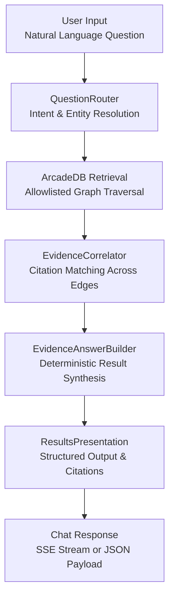

# Chatbot Documentation

## Table of Contents

1. [Overview](#1-overview)
2. [Architecture](#2-architecture)
3. [Intent Routing and Traversal Coverage](#3-intent-routing-and-traversal-coverage)
4. [Configuration and Environment](#4-configuration-and-environment)
5. [API Specification](#5-api-specification)
6. [Testing and Evaluation](#6-testing-and-evaluation)
7. [Related Documentation](#7-related-documentation)

---

## 1. Overview

The ShodhanaKG Chatbot provides graph-grounded question answering over the Ayurvedic biomedical knowledge graph stored in ArcadeDB.

Key characteristics:
- Graph-Grounded Retrieval: Answers are retrieved from graph vertices and relationships across 53 allowlisted ArcadeDB traversal endpoints.
- Deterministic Answer Synthesis: Factual responses are assembled directly from retrieved graph data and literature citations without requiring a Large Language Model.
- Evidence Correlation: Multi-hop graph traversals require matching literature citations (PubMed ID, DOI, or AYUSH Research Portal ID) across intermediate vertices. This eliminates cross-join hallucinations.
- Conversational Assistant: A local Ollama service running Llama 3.2 (3B parameter model, default tag `llama3.2`) can be enabled for conversational phrasing. The model cannot alter or invent facts beyond the retrieved evidence payload.

---

## 2. Architecture

The chatbot backend is organized in modular classes under `webservice/api/core/`:

1. Static FAQ and Metadata Interceptor (`FAQMatcher.php`):
   - Handles general platform queries, usage help, and navigation questions before graph execution.
   - Resolves known scientific entity definitions using deterministic node property lookups.

2. Entity Resolution and Intent Routing (`QuestionRouter.php`, `EntityResolution.php`):
   - Normalizes input question text.
   - Extracts candidate entity names against known graph terminology.
   - Maps questions to one of 53 allowlisted traversal endpoints or prompts the user for clarification.

3. Retrieval Core:
   - Dispatches graph traversal commands to ArcadeDB through `arcade_command()` in `webservice/api/db.php`.
   - Uses `EvidenceCorrelator.php` to match citations across relational paths.
   - Cross-references study identifiers against `reference_catalog_v1.json`, which indexes 410 curated literature publications.

4. Results Presentation (`ResultsPresentation.php`, `EvidenceAnswerBuilder.php`):
   - Structures query outputs into entity lists, property tables, and clinical cards.
   - Assembles explicit literature citation lists with source URLs and publication identifiers.

5. Conversational Layer (`ConversationalAnswer.php`, `LLMClient.php`):
   - Invokes the local Ollama instance via HTTP when enabled.
   - Translates structured evidence into natural language summaries.
   - System prompts constrain the model to the provided evidence payload.



---

## 3. Intent Routing and Traversal Coverage

The chatbot orchestrator covers 53 allowlisted ArcadeDB traversal endpoints:

- Compound Purification:
  - Purification methods for a compound (`compound_methods`).
  - Media used during purification (`compound_media`).
  - Step-by-step Shodhana processes (`compound_shodhana_process`).
- Toxicity and Detoxification:
  - Toxic substances contained in a compound (`compound_toxicity`).
  - Detoxification outcomes and degradation mechanisms (`compound_detoxification`).
- Therapeutic Indications:
  - Diseases treated by purified compounds (`compound_therapeutic_use`).
  - Clinical indications and dosages (`compound_indications`).
- Disease Diagnostics and Characteristics:
  - Clinical symptoms of a disease (`disease_symptoms`).
  - Associated dosha imbalances (`disease_dosha`).
  - Ayurvedic diagnostic classifications (`disease_diagnosis`).
- Therapies and Formulations:
  - Therapies used for a disease (`disease_therapy`).
  - Diseases treated by a therapy (`therapy_disease`).
  - Classical formulations utilized in therapies (`therapy_formulation`, `disease_formulation`).
- Cross-Domain Bridges:
  - Purified compounds formulated into therapeutic preparations (`purified_compound_formulation`).
  - Diseases treated by purified compounds (`purified_compound_disease`).
- Multi-Hop Provenance:
  - Co-cited disease-therapy-formulation pathways (`provenance_subgraph`).
  - Co-cited compound-method-media pathways (`compound_provenance`).

---

## 4. Configuration and Environment

Environment variables are loaded from `.env` via `webservice/api/config.php`:

| Environment Variable | Default Value | Purpose |
|---|---|---|
| `ARCADE_URL` | Derived from `ARCADE_HOST` and `ARCADE_PORT` | Base URL for ArcadeDB HTTP interface |
| `ARCADE_DB` | shodhana | Target ArcadeDB database name |
| `ARCADE_USER` | username | ArcadeDB read-only user |
| `ARCADE_PASS` | password | ArcadeDB password |
| `OLLAMA_URL` | Derived from `OLLAMA_HOST` and `OLLAMA_PORT` | Base URL for the local Ollama service |
| `OLLAMA_MODEL` | llama3.2 | LLM model tag for conversational phrasing |
| `OLLAMA_KEEP_ALIVE` | 5m | Keep-alive duration for the model in memory |
| `KG_NLU_MODEL_ENABLED` | true | Controls whether NLU fallback routing is enabled |
| `CHATBOT_ANSWER_MODE` | grounded | Configures answer synthesis strategy |
| `VITE_CHAT_ENABLED` | true | Frontend toggle for displaying the chatbot widget |

---

## 5. API Specification

### Endpoint: `POST /api/chatbot_response.php`

Accepts a JSON request body:

```json
{
  "question": "Which media are used to purify Copper?",
  "history": [],
  "conversation_id": "optional-session-id",
  "conversation_context": {
    "version": 2
  }
}
```

Response fields:
- `question` (string): The submitted question.
- `answer` (string): The synthesized answer text.
- `status` (string): Query status (`success`, `no_data`, `needs_clarification`, `unsupported`, `entity_not_found`).
- `results` (array): Retrieved entity records and properties.
- `citations` (array): Exact literature references matching the retrieved facts.
- `routing` (object): Resolved intent, matched entity candidates, and target endpoint.

### Endpoint: `GET /api/chatbot_health.php`

Returns service health status:

```json
{
  "ok": true,
  "service": "graph-answer",
  "status": "online",
  "message": "Graph answers are available"
}
```

---

## 6. Testing and Evaluation

Test scripts are located under `webservice/api/tests/`:

- End-to-End Chatbot Tests:
  ```bash
  php webservice/api/tests/test_end_to_end_chatbot.php
  ```
- Conversational Answer Phrasing:
  ```bash
  php webservice/api/tests/test_conversational_answer.php
  ```
- Question Router Tests:
  ```bash
  php webservice/api/tests/test_router.php
  php webservice/api/tests/test_router_history.php
  ```
- Offline Evaluation Cases:
  ```bash
  php webservice/api/tests/run_evaluation_cases.php
  ```
- Live HTTP Evaluation:
  ```bash
  # Requires the API server running on port 8081
  php webservice/api/tests/run_evaluation_cases.php --http
  ```

---

## 7. Related Documentation

- [Chatbot Usage Guide](chatbot_usage_guide.md): User guide for asking questions, reading results, and viewing evidence.
- [Retrieval Core Architecture](dev_docs/RETRIEVAL_CORE.md): Evidence correlation and cross-join prevention.
- [Orchestration Layer Architecture](dev_docs/ORCHESTRATION_LAYER.md): Allowlisted traversal endpoints and state transitions.
- [Evidence-Based Answer Construction](dev_docs/ANSWER_CONSTRUCTION.md): Direct answer synthesis from graph subgraphs.
- [Evaluation Guide](../evaluation/EVALUATION_GUIDE.md): Benchmark methodology, datasets, and metrics.
