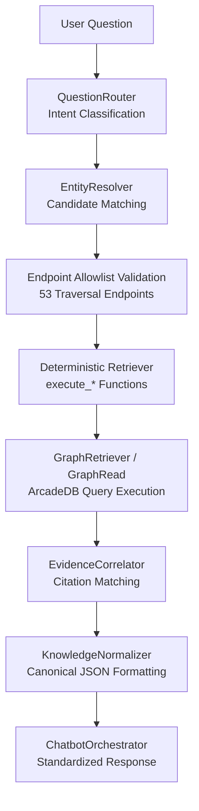

# Chatbot Orchestration Layer Architecture

The Orchestration Layer is the deterministic component of the ShodhanaKG Chatbot infrastructure. It coordinates intent routing and knowledge retrieval to produce a unified, completely hallucination-free JSON payload that can later be consumed by an LLM or natural-language generation module.

## Core Principles

1. **Zero Hallucination:** The Orchestrator operates exclusively as a data-flow router. It NEVER generates factual information or rewrites canonical properties.
2. **Explicit Allowlist:** Exactly 53 allowlisted retrieval endpoints can be executed. It is impossible for the orchestrator to execute arbitrary code or unauthorized paths.
3. **State Transparency:** It rigidly enforces the semantic distinctions between `success`, `no_data`, `needs_clarification`, `unsupported`, and `entity_not_found`.

## Pipeline Flow



## Allowlisted Traversal Endpoints (53 Endpoints)

The Orchestrator maintains an immutable allowlist (`ChatbotOrchestrator::$allowlist`) mapping 53 registered endpoints directly to their corresponding `execute_*` functions:

### 1. Compound & Shodhana Processing (20 endpoints)
- `compound_methods`: Compound → Shodhana_Method
- `compound_shodhana_process`: Compound → Process
- `compound_media`: Compound → Media
- `compound_validation`: Compound → Confirmation_Study
- `compound_toxicity`: Compound → Toxic_Substance
- `compound_detoxification`: Compound → Detoxifies
- `compound_purification`: Compound → Purified_Compound
- `compound_therapeutic_use`: Compound → Disease (treatment)
- `compound_purified_forms`: Compound → Purified_Compound (forms)
- `shodhana_method_validation`: Shodhana_Method → Confirmation_Study
- `shodhana_method_process`: Shodhana_Method → Process
- `process_shodhana_method`: Process → Shodhana_Method
- `process_media`: Process → Media
- `media_process`: Media → Process
- `media_compound`: Media → Compound
- `process_compound`: Process → Compound
- `process_purified_compound`: Process → Purified_Compound
- `purified_compound_process`: Purified_Compound → Process
- `process_next_process`: Process → Next Process
- `next_process_process`: Next Process → Process

### 2. Toxicity, Validation & Indications (8 endpoints)
- `toxic_substance_compound`: Toxic_Substance → Compound
- `toxic_substance_method`: Toxic_Substance → Shodhana_Method
- `method_toxic_substance`: Shodhana_Method → Toxic_Substance
- `confirmation_study_method`: Confirmation_Study → Shodhana_Method
- `confirmation_study_purified_compound`: Confirmation_Study → Purified_Compound
- `purified_compound_validation`: Purified_Compound → Confirmation_Study
- `purified_compound_source`: Purified_Compound → Source Compound
- `indication_compound`: Indication → Compound

### 3. Process Classification (2 endpoints)
- `process_classification`: Process → Classification
- `classification_process`: Classification → Process

### 4. Disease Domain (12 endpoints)
- `disease_symptoms`: Disease → Symptom
- `symptoms_disease`: Symptom → Disease
- `disease_therapy`: Disease → Therapy
- `therapy_disease`: Therapy → Disease
- `disease_formulation`: Disease → Formulation
- `formulation_disease`: Formulation → Disease
- `disease_dosha`: Disease → Dosha
- `dosha_disease`: Dosha → Disease
- `disease_diagnosis`: Disease → Ayurvedic_Diagnosis
- `ayurvedic_diagnosis_disease`: Ayurvedic_Diagnosis → Disease
- `disease_assessment`: Disease → Assessment_Parameter
- `assessment_disease`: Assessment_Parameter → Disease

### 5. Therapy & Formulation (2 endpoints)
- `therapy_formulation`: Therapy → Formulation
- `formulation_therapy`: Formulation → Therapy

### 6. Integrated Cross-Domain Bridge (5 endpoints)
- `integrated_compound_disease`: Compound → Disease (bridge)
- `integrated_disease_compound`: Disease → Compound (bridge)
- `formulation_compound`: Formulation → Compound
- `purified_compound_disease`: Purified_Compound → Disease
- `purified_compound_formulation`: Purified_Compound → Formulation

### 7. Multi-Hop Co-Citation Provenance (4 endpoints)
- `provenance_compound_method_media`: Compound → Method → Media
- `provenance_media_method_compound`: Media → Method → Compound
- `provenance_disease_therapy_formulation`: Disease → Therapy → Formulation
- `provenance_formulation_therapy_disease`: Formulation → Therapy → Disease

## Retriever Function Contract

The 53 validated endpoints expose their core algorithms through modular, reusable PHP functions (e.g., `execute_compound_media()`, `execute_disease_symptoms()`).

- **Input:** Canonical entity string (`$compound`, `$disease`, `$media`, etc.) or structured parameter set.
- **Processing:** Executes parameterized ArcadeDB traversals with static schema caching and Evidence Correlator filters.
- **Output:** Returns a canonical PHP array. The HTTP wrapper layer executes this function to retain external API compatibility.

## Response States

### 1. Success
The router successfully matched an entity and intent, and the query returned correlated factual records.
```json
{
  "status": "success",
  "question": "What media is used for Croton tiglium Linn.?",
  "routing": { ... },
  "retrieval": {
    "status": "success",
    "path": [ ... ],
    "results": [ ... ]
  }
}
```

### 2. No Data
The router successfully matched an entity and intent, but ArcadeDB returned no records that survived Evidence Correlation.
```json
{
  "status": "no_data",
  "routing": { ... },
  "retrieval": { "status": "no_data", "results": [] }
}
```
*Note: This is a successful execution demonstrating the factual absence of data. It is not an error.*

### 3. Needs Clarification
The router resolved the entity but could not discern the intent.
```json
{
  "status": "needs_clarification",
  "reason": "intent_ambiguous",
  "message": "What would you like to know about Copper?"
}
```

### 4. Unsupported
The user asked a question outside the boundaries of the 53 defined retrieval paths (e.g., "What is the molecular weight?").
```json
{
  "status": "unsupported",
  "reason": "no_retrieval_pattern",
  "message": "That question is outside supported ShodhanaKG knowledge retrieval patterns."
}
```

### 5. Entity Not Found
The router failed to resolve the entity in ArcadeDB.
```json
{
  "status": "entity_not_found",
  "message": "The requested compound or disease could not be found in ShodhanaKG."
}
```

## Security & Integrity

- **No Remote HTTP:** The Orchestrator leverages `require_once` to include the retriever files directly, executing them safely as native functions without spawning secondary HTTP requests.
- **Strict Error Boundaries:** The `webservice/api/chatbot_response.php` boundary wraps execution in top-level error handling, ensuring PHP stack traces and warnings are never leaked into the JSON payload.
- **Anti-Hallucination Testing:** The orchestration test suite (`webservice/api/tests/test_chatbot_orchestrator.php`) includes integrity assertions that computationally verify the orchestrator payload is `json_encode`-identical to the raw retriever payload.
