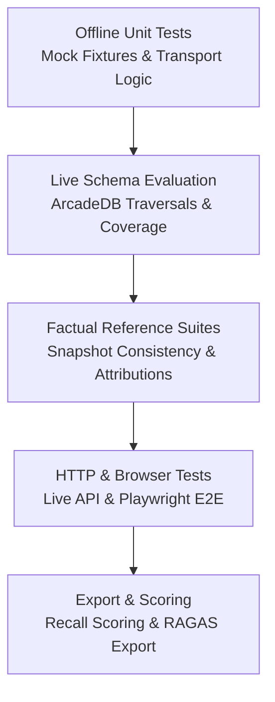

# Chatbot Evaluation Guide

This guide describes how to run the evaluation test suites for the ShodhanaKG chatbot. The evaluation framework tests intent routing, live database schema consistency, deterministic graph retrieval, citation evidence correlation, answer construction, and transport delivery.

---

## 1. Prerequisites

Ensure the following runtime environments and services are available before running evaluation tests:

- **PHP**: PHP 8.2 (required for running evaluation test suites; the API runtime supports PHP 5.6.40+).
- **Python**: Python 3.8 or higher with the standard library (optional `pandas>=2.0.0` for CSV tabular results).
- **Node.js and npm**: Engine requirement `^22.12.0 || ^24.0.0 || >=26.0.0` with npm (required for Playwright browser automation tests).
- **ArcadeDB**: ArcadeDB running on port 2480 (required for live schema and direct database retrieval suites; see the [Quick Start Guide](../../QUICKSTART.md) for database setup).
- **PHP Web Server**: Built-in PHP server or web server running on port 8081 (required for HTTP runner and Playwright tests).
- **Ollama**: Local Ollama daemon running on port 11434 with the `llama3.2` model (needed when evaluating natural-language conversational phrasing).
- **Offline Tests**: Offline unit and assertion tests require neither ArcadeDB nor Ollama.

---

## 2. Environment Variables

Configure the following environment variables as needed:

| Variable | Default | Purpose |
|---|---|---|
| `CHATBOT_EVAL_URL` | `http://127.0.0.1:8081/api/chatbot_response.php` | Full target URL for the live HTTP evaluation runner |
| `CHATBOT_TEST_API` | `http://127.0.0.1:8081` | Base API URL override for Playwright browser tests |
| `SHODHANA_TEST_API_BASE` | `http://127.0.0.1:8081` | Root API URL override for Python HTTP tests |
| `SHODHANA_TEST_PYTHON` | `python` | Python executable override path |
| `ARCADE_URL` | `http://localhost:2480` | Base URL for ArcadeDB HTTP interface |
| `ARCADE_DB` | `shodhana` | ArcadeDB database name |
| `ARCADE_USER` | `username` | ArcadeDB read-only user |
| `ARCADE_PASS` | `password` | ArcadeDB password |
| `OLLAMA_URL` | `http://localhost:11434` | Base URL for the Ollama service |
| `OLLAMA_MODEL` | `llama3.2` | Ollama model tag for conversational assistance |

---

## 3. Test and Suite Commands



### Offline Unit and Assertion Tests

Offline tests execute without network calls, running against self-contained mock graph fixtures.

```bash
php webservice/api/tests/test_traversal_expansion.php
php webservice/api/tests/test_evidence_correlator.php
php webservice/api/tests/test_evaluation_assertions.php
php webservice/api/tests/test_chat_transport.php
php webservice/api/tests/test_evaluation_export.php
python -m unittest discover -s webservice/api/tests -p test_evaluate_fidelity.py
```

**Scope and Coverage:**
- **Proves**: Correctness of direction-sensitive graph traversal logic, citation classifier rules, multi-hop reference correlation, assertion comparison functions, and JSON/SSE transport encoding.
- **Does Not Prove**: Does not verify live database connectivity or validity against live database records; does not evaluate semantic quality of generated natural-language prose.

### Live Schema and Coverage Evaluation

Live schema tests verify registered traversal callables and edge patterns directly against an active ArcadeDB instance.

```bash
php webservice/api/tests/build_traversal_inventory.php --verify-schema
php webservice/api/tests/run_evaluation_cases.php
php webservice/api/tests/test_disease_formulation.php
php webservice/api/tests/run_evaluation_cases.php --filter=eval_traversal_
php webservice/api/tests/run_evaluation_cases.php --filter=eval_coverage_
```

**Command-Line Options for `run_evaluation_cases.php`:**
- `--fixture=PATH`: Path to a custom evaluation fixture JSON file (defaults to `webservice/api/tests/contracts/chatbot_evaluation_cases_v8.json`).
- `--filter=PREFIX`: Filter cases by case ID prefix.
- `--routing`: Test intent classification and entity resolution only, omitting graph retrieval.
- `--dry-run`: Validate fixture syntax and test cases without executing requests.

Exit codes: `0` indicates success, `1` indicates an assertion failure, and `2` indicates a setup or configuration error.

**Scope and Coverage:**
- **Proves**: Alignment of registered traversal callables and query templates with active ArcadeDB schema types; verifies intent routing and deterministic graph retrieval across all 53 allowlisted traversal endpoints (83 evaluation cases in `webservice/api/tests/contracts/chatbot_evaluation_cases_v8.json`).
- **Does Not Prove**: Does not prove that every possible graph query is covered; routing success alone does not prove data retrieval accuracy.

### Independent Factual Reference Suite

The factual reference suite evaluates deterministic query retrieval against frozen database snapshot records.

```bash
python webservice/api/tests/build_factual_ground_truth.py
python -m unittest discover -s webservice/api/tests -p test_factual_ground_truth.py
php webservice/api/tests/test_evaluation_assertions.php
php webservice/api/tests/run_evaluation_cases.php --fixture=webservice/api/tests/fixtures/factual_evaluation_cases_v2.json
```

**Snapshot Capture and Export Commands:**
```bash
# Capture a prospective database snapshot (refuses to overwrite existing files)
php webservice/api/tests/capture_factual_snapshot.php <new_snapshot_path>.json

# Export factual answers from live chatbot
php webservice/api/tests/export_ragas_dataset.php --fixture=webservice/api/tests/fixtures/factual_evaluation_cases_v2.json --output=webservice/api/tests/fixtures/factual_answers.json
```

**Scope and Coverage:**
- **Proves**: Strict fidelity of traversal query outputs to raw database snapshot tables across all 53 allowlisted endpoints (167 factual evaluation cases in `webservice/api/tests/fixtures/expanded_factual_cases_v4.json`), asserting node labels, edge directions, properties, and multi-hop publication reference constraints.
- **Does Not Prove**: Does not prove clinical truth or scientific accuracy of underlying publications; does not evaluate prose phrasing or unasserted database entities.

### Legacy Factual Reference Suite

The legacy factual extension tests flat response field projections against frozen database records.

```bash
python webservice/api/tests/build_legacy_ground_truth.py
python -m unittest discover -s webservice/api/tests -p "test_*ground_truth.py"
php webservice/api/tests/test_evaluation_assertions.php
php webservice/api/tests/run_evaluation_cases.php --fixture=webservice/api/tests/fixtures/legacy_factual_evaluation_cases_v2.json --http
```

**Scope and Coverage:**
- **Proves**: Correctness of legacy flat response projections, full raw edge reading, and reference identity preservation.
- **Does Not Prove**: Does not certify unasserted entities or overall source-document truth; does not evaluate natural-language phrasing.

### HTTP and Browser Validation

HTTP tests validate live service communication, response formatting, and browser interaction.

```bash
# Playwright browser integration tests (requires running frontend and backend)
npx --prefix webservice/frontend playwright test tests/traversal.spec.ts --config=playwright.external.config.ts --project=chromium
npx --prefix webservice/frontend playwright test --config=playwright.external.config.ts --project=chromium --grep "Route smoke|Mobile"

# Live HTTP runner
php webservice/api/tests/run_evaluation_cases.php --http --filter=eval_traversal_
```

**Scope and Coverage:**
- **Proves**: End-to-end HTTP request handling, response parsing, error status codes, and browser UI interaction flows.
- **Does Not Prove**: Does not guarantee absence of semantic phrasing hallucinations in natural-language summaries.

### Export and Offline Scoring

Export utilities capture live chatbot outputs, while scoring scripts evaluate fidelity and entity mention recall without external model calls.

```bash
# Export responses from live chatbot
php webservice/api/tests/export_ragas_dataset.php

# Evaluate exported dataset fidelity
python webservice/api/tests/evaluate_fidelity.py

# Custom input and output paths
python webservice/api/tests/evaluate_fidelity.py --input=webservice/api/tests/fixtures/ragas_dataset.json --output=webservice/api/tests/fixtures/fidelity_results.csv
```

**Scope and Coverage:**
- **Proves**: Automated extraction and scoring of chatbot execution status, endpoint routing accuracy, and entity mention recall against exported answers.
- **Does Not Prove**: Entity mention recall is a proxy metric and does not establish factual correctness; cannot score abstention correctness without ground-truth labels.

---

## 4. Fixture Format Specification

Evaluation fixtures are JSON files structured as an array of test case objects:

- **Required Fields**:
  - `id`: Unique string identifier for the test case.
  - `question`: Query string submitted to the chatbot.
  - `expected_status`: Expected retrieval status code (`success`, `no_data`, `unsupported`, `needs_clarification`, `entity_not_found`, or `error`).
- **Optional Routing and Assertion Fields**:
  - `expected_endpoint`: Name of expected traversal endpoint callable.
  - `expected_entity_type`: Target entity domain or type name (e.g., `Disease`, `Compound`).
  - `expected_entity`: Target entity name string.
  - `expected_final_status`: Expected top-level HTTP response status code.
  - `expected_reason`: Explanation string for `no_data` or `unsupported` questions.
  - `history`: Array of conversation turn objects `[{"role": "user"|"bot", "text": "..."}]`.
  - `expected_results`: Array of row objects; each row is asserted as a recursive subset against returned rows.
  - `forbidden_results`: Array of row objects; asserts that no returned row matches these property combinations.
  - `expected_result_count`: Integer specifying exact returned result count.
  - `expected_faq_id`: String identifier for FAQ educational static responses.

---

## 5. Limitations and Interpretation

- The evaluation suites test retrieval fidelity, schema consistency, and transport reliability; they do not verify external medical truth of published studies.
- Entity mention recall computed during offline scoring is a proxy metric and does not guarantee semantic accuracy.
- Deterministic graph answers are constructed from verified database facts; see [Answer Construction](../chatbot/dev_docs/ANSWER_CONSTRUCTION.md) for details.
- For backend query execution details, refer to [Backend Documentation](../webservice/BACKEND_DOCUMENTATION.md) and [Chatbot Documentation](../chatbot/CHATBOT.md).
