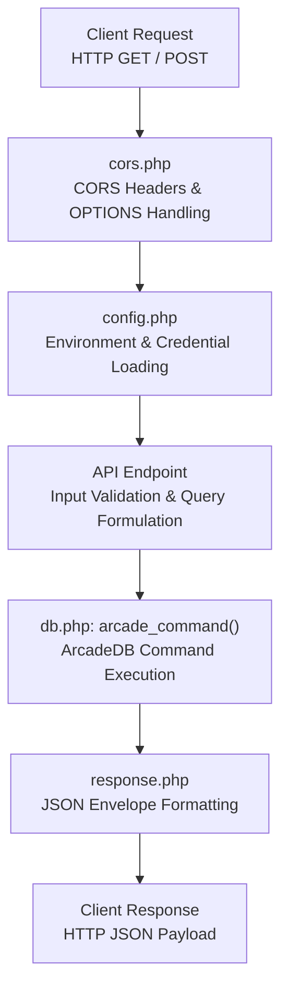

# Backend Documentation

## Table of Contents

1. [Tech Stack](#1-tech-stack)
2. [Architecture Overview](#2-architecture-overview)
3. [Database: ArcadeDB](#3-database-arcadedb)
4. [Connection Layer: db.php](#4-connection-layer-dbphp)
5. [Configuration and Environment](#5-configuration-and-environment)
6. [API Endpoints](#6-api-endpoints)
7. [Cross-Cutting Concerns](#7-cross-cutting-concerns)
8. [Testing](#8-testing)
9. [File Reference](#9-file-reference)

---

## 1. Tech Stack

| Category | Technology | Version |
|---|---|---|
| Language | PHP | 5.6.40+ |
| Database | ArcadeDB | Multi-model graph database |
| HTTP Transport | cURL / stream socket client | Fallback chain |
| Protocol | ArcadeDB REST API | HTTP POST to `/api/v1/command/<database>` |
| Data Format | JSON over HTTP | UTF-8 |
| CORS | Header-based | Configurable via `ALLOWED_ORIGINS` |
| Web Server | Apache / Nginx / PHP built-in server | mod_php, PHP-FPM, or CLI server |
| Chatbot LLM | Llama 3.2 3B | Default model tag `llama3.2` via Ollama |

### Runtime Compatibility

The API supports PHP 5.6.40+ and is regression-tested on PHP 5.6.40 and 8.2.

Runtime compatibility details:
- Backward-compatible type checking and JSON parsing are implemented in `webservice/api/core/PhpCompatibility.php`.
- A bundled mbstring polyfill is provided in `webservice/api/vendor/polyfill-mbstring/`.
- Modern syntax features such as typed class properties, union types, arrow functions, and the nullsafe operator are avoided in production API scripts.
- Both `array()` and short array syntax `[]` are used.

---

## 2. Architecture Overview

The backend API is a stateless service layer between the React frontend and the ArcadeDB graph database.

Request lifecycle:
1. The client sends an HTTP request to an endpoint in `webservice/api/`.
2. `cors.php` handles CORS preflight requests (`OPTIONS`) and applies access control headers based on `ALLOWED_ORIGINS`.
3. `config.php` loads configuration values from `.env` via `shodhana_load_env()`.
4. The endpoint validates input parameters.
5. Queries are sent to ArcadeDB through `arcade_command()` in `db.php`.
6. Results are formatted as JSON envelopes and returned using `api_ok()` or `api_fail()` from `response.php`.



---

## 3. Database: ArcadeDB

ArcadeDB stores the curated Ayurvedic biomedical knowledge graph.

Graph statistics:
- 2,532 total nodes
- 10,123 total relationships
- 17 vertex types
- 21 edge types
- Literature reference citations: 410 publications indexed across PubMed, DOI, and AYUSH Research Portal records.

### Vertex Types

| Vertex Type | Domain | Description |
|---|---|---|
| `Disease` | Disease | Clinical diseases and pathological conditions |
| `Symptom` | Disease | Clinical signs and symptoms |
| `Ayurvedic_Diagnosis` | Disease | Classical Ayurvedic disease classifications |
| `Dosha` | Disease | Physiological humors (Vata, Pitta, Kapha) |
| `Therapy` | Disease | Therapeutic interventions and treatment modalities |
| `Formulation` | Disease | Classical multi-ingredient medicinal formulations |
| `Assessment_Parameter` | Disease | Objective and subjective diagnostic markers |
| `Compound` | Compound | Raw botanical, mineral, or animal source substances |
| `Toxic_Substance` | Compound | Toxic constituents and chemical toxicants |
| `Shodhana_Method` | Compound | Classical purification and detoxification techniques |
| `Media` | Compound | Liquid and organic processing media used in Shodhana |
| `Purified_Compound` | Compound | Detoxified and processed end-products |
| `Shodhana_Type` | Compound | Methodological category of Shodhana process |
| `Confirmation_Study` | Compound | Experimental study evaluating purification outcomes |
| `Process` | Compound | Procedural step in purification workflows |
| `Indication` | Compound | Therapeutic indication for purified compounds |
| `Ayurvedic_Formulation` | Compound | Formulation incorporating purified medicinal compounds |

### Edge Types

The graph contains 21 relationship types:
- Disease domain (9 types): `ASSESS`, `USES_FORMULATION`, `TREATED_BY`, `PRE_TREATED_BY`, `POST_TREATED_BY`, `HAS_SYMPTOM`, `HAS_DOSHA_IMBALANCE`, `HAS_AYURVEDIC_DIAGNOSIS`, `USED_FOR_TREATMENT`.
- Compound domain (12 types): `UNDERGOES`, `CONTAINS`, `DERIVED_FROM`, `TREATS`, `PRODUCES`, `CONFIRMS_SAFETY_OF`, `USES_MEDIA`, `VALIDATED_BY`, `DETOXIFIES`, `CLASSIFIED_AS`, `USED_IN_FORMULATION`, `FOLLOWED_BY`.

### Data Population Pipeline

The graph is rebuilt from `data/graph_export/neo4j-export.json`. The full pipeline from source data is:
1. **Neo4j Loading**: The source CSV files are provided in `data/csv/nodes/` and `data/csv/relations/`. Copy node CSV files and relationship CSV files into the Neo4j latest (Desktop or Server) `import` directory, then load into Neo4j latest (Desktop or Server) using [`Create_graph.Cypher`](../../arcadedb/Create_graph.Cypher):
   ```bash
   cat arcadedb/Create_graph.Cypher | cypher-shell -u username -p password -d neo4j
   ```
2. **JSON Export**: Export the Neo4j graph using [`Export.Cypher`](../../arcadedb/Export.Cypher):
   ```cypher
   CALL apoc.export.json.all("neo4j-export.json", {});
   ```
3. **ArcadeDB Import**: Create database `shodhana` and import the exported JSON into ArcadeDB using [`Migrate_to_ArcadeDB.sql`](../../arcadedb/Migrate_to_ArcadeDB.sql):
   ```bash
   bin/console.sh arcadedb/Migrate_to_ArcadeDB.sql
   ```
4. **Sanity Verification**: Execute post-import sanity queries in [`Migrate_to_ArcadeDB.sql`](../../arcadedb/Migrate_to_ArcadeDB.sql) to confirm 2,532 total nodes, 10,123 total relationships, 17 vertex types, 21 edge types.

---

## 4. Connection Layer: db.php

Database communication is encapsulated in `webservice/api/db.php`.

The primary entry point is `arcade_command($command, $language, $params, $timeout)`:
- Target endpoint: Constructs target URL using `ARCADE_URL` and `ARCADE_DB`.
- Payload: Encodes command text and query language (`sql` or `cypher`) into a JSON payload.
- Authentication: Transmits HTTP Basic Authentication credentials from `ARCADE_USER` and `ARCADE_PASS`.
- Transport fallback: Uses cURL when the extension is available. If cURL is absent, falls back to `arcade_command_socket()` using raw stream sockets.
- Timeout handling: Enforces bounded deadline limits to prevent worker pool exhaustion.

---

## 5. Configuration and Environment

Configuration is centralized in `webservice/api/config.php`.

On startup, `config.php` searches for a `.env` file at:
1. Path defined in `SHODHANA_ENV_FILE` (if set)
2. Repository root `.env`
3. Parent directory `.env`
4. Working directory `.env`

The `shodhana_load_env()` helper parses key-value pairs without overriding variables already defined in the operating system environment.

### Environment Variables

| Variable Name | Default Value | Purpose |
|---|---|---|
| `ARCADE_HOST` | localhost | ArcadeDB server host |
| `ARCADE_PORT` | 2480 | ArcadeDB HTTP port |
| `ARCADE_URL` | Derived from host and port | Full base URL for ArcadeDB |
| `ARCADE_DB` | shodhana | ArcadeDB database name |
| `ARCADE_USER` | username | ArcadeDB read-only user |
| `ARCADE_PASS` | password | ArcadeDB password |
| `API_HOST` | localhost | Backend API server host interface |
| `API_PORT` | 8081 | Backend API server port |
| `API_STORAGE_DIR` | webservice/api/storage | Storage directory for runtime caches |
| `API_CACHE_DIR` | webservice/api/storage/cache | Cache directory for resolved entities |
| `ALLOWED_ORIGINS` | * | Permitted CORS origins |
| `API_VERSION` | v1 | API version indicator string |
| `OLLAMA_HOST` | localhost | Ollama server host |
| `OLLAMA_PORT` | 11434 | Ollama server port |
| `OLLAMA_URL` | Derived from host and port | Ollama server base URL |
| `OLLAMA_MODEL` | llama3.2 | Ollama model identifier |
| `OLLAMA_KEEP_ALIVE` | 5m | Model keep-alive memory window |

---

## 6. API Endpoints

### Health and Diagnostics

- `health.php`: Verifies database connection by running `SELECT 1` against ArcadeDB. Returns service name and API version.
- `chatbot_health.php`: Verifies that graph question answering is online.

### Core Graph and Search Endpoints

- `search.php`: Performs case-insensitive search on vertex names and descriptions within a domain (`disease`, `compound`, or `integrated`).
- `graph.php`: Returns subgraphs around seed vertices up to a specified traversal depth.
- `node.php`: Retrieves a single vertex by record ID (`@rid`) or type and name.
- `kg-stats.php`: Returns total node count, edge count, and study count.
- `counts.php`: Returns vertex counts grouped by category for a given domain.
- `category-stats.php`: Returns paginated relationship tables for a selected category.
- `provenance-subgraph.php`: Retrieves 2-hop clinical paths (Disease -> Therapy -> Formulation) with verified PubMed citations.
- `compound-provenance.php`: Retrieves compound purification paths (Compound -> Shodhana_Method -> Media).
- `bridge-stats.php`: Retrieves cross-domain bridge records connecting purified compounds to formulations and clinical indications.

### Chatbot Endpoints

- `chatbot_response.php`: Primary conversational question-answering endpoint. Accepts a JSON request with `question`, optional `history`, and `conversation_context`. Returns structured answers and evidence citations.
- `route_question.php`: Diagnostic routing endpoint testing `QuestionRouter::route()` without executing traversal queries.

### Allowlisted Traversal Endpoints

The backend implements 53 allowlisted ArcadeDB traversal endpoints covering specific relationship paths across disease, compound, and integrated query patterns.

---

## 7. Cross-Cutting Concerns

- CORS Handling: Handled in `cors.php`. When `ALLOWED_ORIGINS` is `*`, wildcards are emitted. Otherwise, incoming `Origin` headers are matched against comma-separated allowlists.
- Response Formatting: Handled in `response.php`. Standard envelopes include `{"ok": true, ...}` for successes and `{"ok": false, "error": {"code": "...", "message": "..."}}` for errors.
- Error Sanitization: Database connection strings, SQL query text, and server paths are stripped from error messages before responses are sent to clients.
- Evidence Correlation: Implemented in `webservice/api/core/EvidenceCorrelator.php`. Multi-hop traversals require matching citation identifiers across edges to eliminate cross-join hallucinations.

---

## 8. Testing

Backend test suites are located in `webservice/api/tests/`:

- PHP Compatibility:
  ```bash
  php webservice/api/tests/test_php_compatibility.php
  ```
- Boundary and Validation Tests:
  ```bash
  php webservice/api/tests/test_audit_boundaries.php
  php webservice/api/tests/test_planned_updates.php
  php webservice/api/tests/test_ui_refinements.php
  ```
- Release Remediation Suite:
  ```bash
  php webservice/api/tests/test_release_remediation.php
  ```
- HTTP Security Checks:
  ```bash
  # Requires the API server running on port 8081
  php webservice/api/tests/test_security_http.php
  ```
- Python Unit Tests:
  ```bash
  python -m unittest discover -s webservice/api/tests -p "test_*.py"
  ```
- Chatbot Benchmark Suite:
  ```bash
  php webservice/api/tests/run_evaluation_cases.php
  ```

---

## 9. File Reference

Core backend files in `webservice/api/`:
- `config.php`: Central configuration and `.env` loader.
- `db.php`: Database connection handler and transport adapter.
- `cors.php`: CORS headers and preflight handling.
- `response.php`: JSON response helpers.
- `serve.php`: Local development server runner.
- `core/ModelConfig.php`: Ollama connection resolver.
- `core/PhpCompatibility.php`: Backward compatibility functions.
- `core/QuestionRouter.php`: Query intent classifier and candidate matcher.
- `core/EntityResolution.php`: Entity identifier extractor.
- `core/ResultsPresentation.php`: Structured answer and citation formatter.
- `core/EvidenceCorrelator.php`: Citation matching across traversal edges.
- `core/EvidenceAnswerBuilder.php`: Deterministic answer generator.
- `core/ConversationalAnswer.php`: LLM phrasing assistant.
- `core/LLMClient.php`: HTTP client for local Ollama service.
- `core/reference_catalog_v1.json`: Curated reference publication index.
