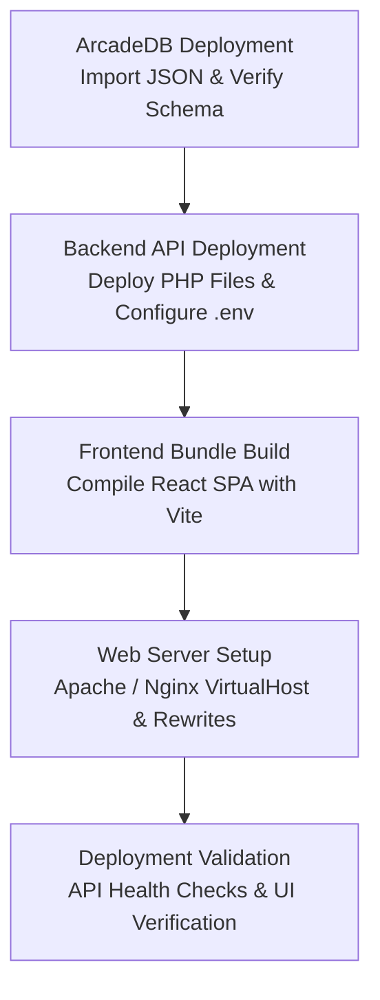

# Deployment Guide

`APP_BASE_PATH`: the URL subpath where the portal is served; set it as VITE_API_BASE at build time and in the web server rules.

## Table of Contents

1. [Architecture Overview](#1-architecture-overview)
2. [Prerequisites](#2-prerequisites)
3. [Database Deployment (ArcadeDB)](#3-database-deployment-arcadedb)
4. [Backend API Deployment](#4-backend-api-deployment)
5. [Frontend Build and Deployment](#5-frontend-build-and-deployment)
6. [Web Server Configuration](#6-web-server-configuration)
7. [Chatbot Service Setup](#7-chatbot-service-setup)
8. [Post-Deployment Verification](#8-post-deployment-verification)
9. [Operational Maintenance](#9-operational-maintenance)

---

## 1. Architecture Overview

A production ShodhanaKG deployment consists of three main tiers:
- Frontend: Single-page React application compiled to static assets (HTML, JavaScript, CSS).
- Backend API: PHP service layer deployed to an HTTP web server (Apache or Nginx) communicating with the database.
- Database: ArcadeDB server storing the graph database.
- Chatbot LLM: Local Ollama daemon providing natural language phrasing assistance.



---

## 2. Prerequisites

Verify that the target production environment meets the following requirements:
- Operating System: Linux or Unix-like server environment (Windows Server also supported).
- Web Server: Apache HTTP Server with `mod_rewrite` and `mod_php` or `mod_proxy_fcgi`, or Nginx with PHP-FPM.
- PHP: Version 5.6.40+. Required extensions: `json`, `mbstring` (or bundled polyfill), and `curl` (recommended).
- Database: ArcadeDB running with Java 11 or Java 17.
- Neo4j: Neo4j latest (Desktop or Server) (for source graph population and export).
- Build Environment: Node.js (`^22.12.0 || ^24.0.0 || >=26.0.0`) and npm for compiling the frontend bundle.
- Ollama: Ollama daemon for conversational chatbot capabilities.

---

## 3. Database Deployment (ArcadeDB)

The graph is rebuilt from `data/graph_export/neo4j-export.json`.

1. Source Graph Population in Neo4j:
   If rebuilding the graph from raw CSV files, the source CSV files are provided in `data/csv/nodes/` and `data/csv/relations/`. Copy node CSV files and relationship CSV files to the Neo4j latest (Desktop or Server) `import` directory, then load the dataset into Neo4j latest (Desktop or Server) using [`Create_graph.Cypher`](../../arcadedb/Create_graph.Cypher):
   ```bash
   cat arcadedb/Create_graph.Cypher | cypher-shell -u username -p password -d neo4j
   ```
   This creates schema constraints, loads 17 vertex types, and builds 21 edge types with PubMed, AYUSH, and DOI reference annotations.

2. Export Graph to JSON:
   Enable APOC file exports (`apoc.export.file.enabled=true` in `conf/apoc.conf`) and run [`Export.Cypher`](../../arcadedb/Export.Cypher):
   ```cypher
   CALL apoc.export.json.all("neo4j-export.json", {});
   ```
   The export writes `neo4j-export.json` in JSON Lines format.

3. Install and Start ArcadeDB:
   Download and unpack ArcadeDB on the database host. Start the ArcadeDB server:
   ```bash
   bin/server.sh
   ```

4. Database Creation, Import, and Sanity Checks:
   Execute [`Migrate_to_ArcadeDB.sql`](../../arcadedb/Migrate_to_ArcadeDB.sql) using the ArcadeDB console:
   ```bash
   bin/console.sh arcadedb/Migrate_to_ArcadeDB.sql
   ```
   Or run the commands interactively:
   ```sql
   CONNECT remote:localhost username password;
   CREATE DATABASE shodhana;
   DISCONNECT;
   CONNECT remote:localhost/shodhana username password;
   IMPORT DATABASE file:///data/graph_export/neo4j-export.json;
   ```
   The ArcadeDB server reads this path. Adjust it if the repository is at a different location on the server.

   Run post-migration sanity checks to verify 2,532 total nodes, 10,123 total relationships, 17 vertex types, 21 edge types, 0 edges missing `ref`, and 0 vertices missing `name`.

5. Configure Database User:
   Create a dedicated user with read-only permissions for the API:
   ```sql
   CREATE USER username IDENTIFIED BY 'password'
   GRANT DATABASE.READ TO username
   ```

6. Verify Database Service:
   Confirm that ArcadeDB is reachable:
   ```bash
   curl http://localhost:2480/api/v1/ready
   ```

---

## 4. Backend API Deployment

1. Code Placement:
   Copy the contents of `webservice/api/` into the web server directory.
2. Storage and Cache Setup:
   Ensure the storage directories exist and are writable by the web server process:
   ```bash
   mkdir -p webservice/api/storage/cache
   chmod -R 775 webservice/api/storage
   ```
3. Environment Configuration:
   Configure environment variables on the web server or create a `.env` file in the application directory:
   - `ARCADE_URL`: `http://localhost:2480`
   - `ARCADE_DB`: `shodhana`
   - `ARCADE_USER`: `username`
   - `ARCADE_PASS`: `password`
   - `ALLOWED_ORIGINS`: Permitted frontend origin URL
   - `API_STORAGE_DIR`: Relative or absolute path to the storage folder
   - `API_CACHE_DIR`: Relative or absolute path to the cache folder
   - `API_VERSION`: `v1`
   - `OLLAMA_URL`: `http://localhost:11434` (if chatbot is enabled)
   - `OLLAMA_MODEL`: `llama3.2`

---

## 5. Frontend Build and Deployment

1. Configure Build Environment:
   In `.env.production` (or `.env`), set the API base path and chatbot status:
   ```ini
   VITE_API_BASE=/APP_BASE_PATH
   VITE_CHAT_ENABLED=true
   ```
   If deploying to the server root, leave `VITE_API_BASE=` empty to use relative paths.
2. Compile Production Bundle:
   Run the build script from `webservice/frontend/`:
   ```bash
   npm install
   npm run build
   ```
   The build artifacts are emitted to `webservice/frontend/dist/`.
3. Deploy Static Files:
   Copy the contents of `dist/` to the web server document root or target application directory.

---

## 6. Web Server Configuration

### Apache HTTP Server

Ensure `mod_rewrite` is enabled. A reference configuration is provided in `apache.conf.example`.

Example configuration snippet for subdirectory deployments:

```apache
<Directory "/path/to/webroot">
    Options -Indexes +FollowSymLinks
    AllowOverride None
    Require all granted

    RewriteEngine On
    RewriteBase /APP_BASE_PATH/

    # Forward API requests to the PHP backend
    RewriteRule ^api/(.*)$ webservice/api/$1 [L,QSA]

    # Route all other non-file requests to index.html
    RewriteCond %{REQUEST_FILENAME} !-f
    RewriteCond %{REQUEST_FILENAME} !-d
    RewriteRule ^ index.html [L]
</Directory>
```

### Nginx

Example configuration snippet for single-page application routing and PHP-FPM:

```nginx
location /APP_BASE_PATH/ {
    try_files $uri $uri/ /APP_BASE_PATH/index.html;
}

location ~ \.php$ {
    include fastcgi_params;
    fastcgi_param SCRIPT_FILENAME $document_root$fastcgi_script_name;
    fastcgi_pass unix:/run/php/php-fpm.sock;
}
```

---

## 7. Chatbot Service Setup

If the conversational assistant is enabled:

1. Install Ollama on the server.
2. Start the service daemon:
   ```bash
   ollama serve
   ```
3. Download the model:
   ```bash
   ollama pull llama3.2
   ```
4. Verify the Ollama port (11434) is accessible to the PHP backend.
5. Set `OLLAMA_URL` in the backend environment.

---

## 8. Post-Deployment Verification

Execute smoke checks to confirm production health:

1. Backend Health Check:
   ```bash
   curl http://localhost:8081/api/health.php
   ```
   Expected response: `{"ok":true,"service":"shodhana-api","version":"v1","arcade":{"connected":true,...}}`.
2. Chatbot Health Check:
   ```bash
   curl http://localhost:8081/api/chatbot_health.php
   ```
   Expected response: `{"ok":true,"service":"graph-answer","status":"online",...}`.
3. Test Search Endpoint:
   ```bash
   curl "http://localhost:8081/api/search.php?domain=disease&q=Eczema&limit=1"
   ```
   Expected response: JSON object containing matched nodes array.
4. Browser Validation:
   Open the deployed URL in a browser. Verify navigation across the Disease, Compound, and Integrated Explorer views.

---

## 9. Operational Maintenance

- Log Monitoring: Regularly monitor PHP error logs and ArcadeDB server logs for connection or query errors.
- Cache Management: If graph data or schemas are re-imported, clear `webservice/api/storage/cache/` to ensure fresh entity resolution.
- Database Backups: Use ArcadeDB backup utilities to create scheduled database backups.
- Security Headers: Verify that `ALLOWED_ORIGINS` restricts cross-origin API requests to trusted domains in production.
